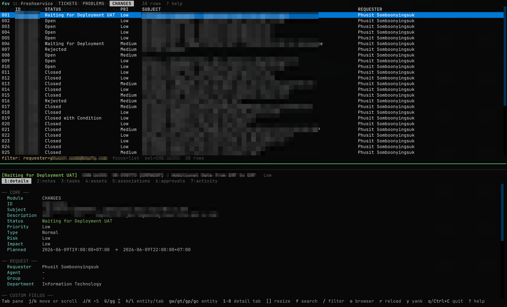

# fsv

Freshservice CLI. Drives changes, tickets, and problems via session-cookie auth; no API key needed.



Interactive TUI with filter autocomplete, pagination, fulltext search, and keyboard navigation. Launch with `fsv tui`.

## Quickstart

**1. Install**

```bash
uv tool install git+https://github.com/lazykern/fsv.git
```

**2. Setup** — interactive wizard configures domain, auth, shell completion, and defaults:

```bash
fsv setup
```

Or set up manually:

```bash
fsv auth login --browser --domain acme.freshservice.com
# complete SSO/MFA in the opened browser (see Login section below)
```

**3. Use it**

```bash
fsv auth status                            # confirm login
fsv changes ls --where status=Open         # list open changes
fsv changes get CHN-1234                   # get a change
fsv tickets ls --where requester=alice@example.com
fsv tui                                    # interactive TUI
```

---

## How it works

fsv calls the **internal** `/api/_/` endpoints the Freshservice web UI uses, not the public v2 REST API. These endpoints expose richer data with no published rate cap. Log in once through browser-assisted auth or paste a valid browser session cookie; fsv stores it locally.

fsv also uses the public v2 API (`/api/v2/`) for schema, task writes, and approvals. Both paths share the same cookie.

## Install

### End users

Install from GitHub:

```bash
uv tool install git+https://github.com/lazykern/fsv.git
```

Upgrade later with:

```bash
uv tool upgrade fsv
```

### Contributors / local checkout

```bash
git clone git@github.com:lazykern/fsv.git
cd fsv
uv sync
uv tool install --editable .
```

Run ad hoc from checkout: `uv run fsv ...`

Update local editable install:

```bash
cd /path/to/fsv
git pull --ff-only
uv sync
uv tool install --editable .
```

### Shell completion

```bash
fsv completion install
fsv completion refresh
exec $SHELL
```

Completion is schema-aware after cache refresh. Login auto-refreshes cache.

```bash
fsv tickets ls --where sta<TAB>            # status=
fsv tickets ls --where status=<TAB>        # Open, Pending, ...
fsv changes ls --where requester=ali<TAB>  # requester email (network)
fsv changes fields --choices add_<TAB>     # add_database_task, ...
```

Completion reads the local schema cache and skips network calls by default. Enable network requester/agent completion:

```bash
fsv config set completion.network on
```

Remote completion requires a 2+ character prefix; without one, the shell falls back to file completion.

Debug:

```bash
fsv completion doctor
```

## Upgrade / staying current

Check installed version:

```bash
fsv --version
```

fsv does not auto-update itself. To know when new release ships:

- Watch GitHub releases: <https://github.com/lazykern/fsv/releases>
- In GitHub UI: **Watch → Custom → Releases**

If you installed from GitHub with `uv tool install git+https://github.com/lazykern/fsv.git`, upgrade with:

```bash
uv tool upgrade fsv
```

If you run from local checkout only:

```bash
cd /path/to/fsv
git pull --ff-only
uv sync
```

## Login

Preferred path: let fsv open an isolated browser, finish SSO/MFA there, then fsv checks every 2 seconds until it can read the browser cookies via CDP and store them.

```bash
fsv auth login --browser --domain acme.freshservice.com
```

Browser login requires Chrome, Chromium, Edge, or Brave. If fsv cannot find your browser, set `FSV_BROWSER=/path/to/browser`.

Manual fallback still works:

1. Open `https://acme.freshservice.com` in any browser, complete SSO login.
2. Open DevTools → Network tab → click any `/api/_/...` request.
3. Copy the value of the `Cookie:` request header (right-click → Copy value).
4. Paste into fsv:

```bash
fsv auth login --domain acme.freshservice.com              # interactive prompt
pbpaste | fsv auth login --domain acme.freshservice.com --header -
fsv auth login -d acme.freshservice.com -H "_x_m=...; _x_d=...; ..."
```

The browser/Network cookie set includes HttpOnly cookies (`_itildesk_session`, `user_credentials`) that `document.cookie` cannot read; fsv needs these for API access.

### Storage backends

```bash
fsv auth login --store file       # ~/.config/fsv/session.json (plain JSON, chmod 600)
fsv auth login --store argon      # encrypted file using Argon2id + AES-256-GCM
fsv auth login --store keychain   # macOS Keychain (encrypted at rest)
fsv auth logout                   # wipe file + Keychain + backend preference
```

Omit `--store` during interactive login to choose `file`, `argon`, or `keychain`. Default is Keychain on macOS, otherwise file.
Switching backend re-saves to the new location and removes the old copy.

Argon mode asks for a passphrase on save and read. Keychain first-read prompts macOS access dialog → click "Always Allow" once → silent thereafter. No admin/sudo required.

### Why not username/password?

The Freshworks login endpoint requires reCAPTCHA Enterprise tokens (Google JS sandbox + risk signals) with Cloudflare bot detection on top. No headless username/password path works; use `--browser` or paste the Cookie header manually.

**Security note**: browser-assisted login launches an isolated temporary browser profile with CDP enabled and does not read existing Chrome/Safari cookie databases, keychains, or profiles. Do not rely on saved browser passwords in that window persisting after login. Manual login reads only what you paste.

## Quick start

```bash
# Check auth
fsv auth status

# List open changes
fsv changes ls --where status=Open

# Get a change with full detail
fsv changes get CHN-1234

# Update a ticket
fsv tickets update INC-5678 --status Pending --agent alice@example.com

# Add a private note to a change
fsv changes add-note CHN-1234 "PVT result PASS"

# Clone a change
fsv changes clone CHN-1234 --with-tasks --with-planning

# Download all attachments
fsv changes download CHN-1234 --all --dir ./evidence
```

## Commands

```
fsv tui                                    # interactive TUI

fsv changes  ls | search | get | update | create | clone | download | url | state | approvals | activity | tasks | tasks-update | tasks-delete | assets | associations | add-note | notes | fields | lookup | views
fsv tickets  ls | search | get | update | url | reply | activity | tasks | approvals | associations | download | conversations | fields | lookup | views
fsv problems ls | search | get | update | url | add-note | notes | activity | tasks | download | fields | lookup | views

fsv setup                                  # interactive setup wizard
fsv auth login --domain acme.freshservice.com
fsv auth status
fsv config set <key> <value>
fsv cache status | refresh | clear
fsv journal ls | tail | path               # local write journal
```

### List

```bash
fsv changes ls                              # list changes
fsv changes ls --all                        # auto-paginate
fsv tickets ls --where requester=alice@example.com --where 'created_at>=2025-05-01T00:00:00+07:00'
fsv tickets ls --where agent="Jane Agent"
fsv tickets ls --where status=Open --where priority=High
fsv tickets ls --where status=Open --where status=Pending --or
fsv changes ls --where "Change Category=Infrastructure"
fsv tickets ls --where status=Open --debug  # show resolved query_hash

# Operators: = (equals), != (not equals). For dates: >=, <=, >, < also work.
fsv tickets fields requester                # schema-discovered fields
fsv tickets fields --default                # portable Freshservice fields
fsv changes fields --custom                 # tenant-specific fields
fsv changes fields --required               # fields required to create (the * column marks them)
fsv changes fields --choices "Change Category"
fsv tickets lookup requester alice@example.com
fsv changes lookup "Change Category" Infrastructure
fsv tickets ls --output csv                 # table | json | csv | tsv (-o also works)
fsv problems views                            # list saved views
fsv problems ls --view "All Problems"
```

### Search / Get / Activity / Tasks

```bash
fsv tickets search "database error"
fsv tickets search "payment timeout" -o tsv
fsv changes get CHN-1234
fsv changes get CHN-1234 --stats       # adds planning_fields + timestamps
fsv changes get CHN-1234 --json | jq .
fsv changes activity CHN-1234 -n 20
fsv changes tasks CHN-1234
fsv changes url CHN-1234
```

### Write

```bash
fsv changes update CHN-1234 --status Closed --priority Medium --dry-run
fsv changes update CHN-1234 --planning "Reference Documents" --description "Evidence attached" --file evidence.xlsx
fsv changes create                                   # opens $VISUAL/$EDITOR with a JSON template (reopens with the error if the JSON is invalid)
fsv changes create --subject "Patch DB" --status Open --priority High --set "Change Category=Infrastructure"
fsv changes create --subject "Patch DB" --set "requester=alice@example.com" --no-input   # scriptable
fsv changes create --dry-run
fsv changes clone CHN-1234 --dry-run --with-tasks   # list side effects first
fsv changes clone CHN-1234 --with-tasks --with-planning --yes
fsv changes download CHN-1234 --all --dir ./evidence
fsv changes assets categories
fsv changes assets search CHN-1234 app
fsv changes assets search CHN-1234 myapp --category "Application Portfolio"
fsv changes assets add CHN-1234 myapp --category "Application Portfolio" --dry-run
fsv changes assets pick CHN-1234 --yes
fsv changes associations add CHN-1234 SR-5678 --dry-run
fsv tickets update INC-9012 --status Pending --agent alice@example.com
fsv tickets update INC-9012 --group "Service Desk"
fsv changes add-note CHN-1234 "PVT result PASS"      # private by default
fsv changes add-note CHN-1234 "..." --public
fsv tickets reply INC-9012 "<HTML or text>" --dry-run
```

### Safety confirmations

One gate checks the final request body (after flags, `--set` and `--edit` are merged). It asks `y/N` interactively, and refuses with exit 2 under `--no-input` or without a TTY unless you pass `--yes`. `--dry-run` never asks and lists `requires_confirmation`.

It covers: any change status transition (unchanged status is ignored), ticket/problem moves to resolved/closed, agent/group reassignment, task status and reassignment, public notes, ticket replies, and `clone --with-tasks`. Paths: quick flags, `--set status=...`, `update --edit`, `tasks-update` (flags and `--edit`), `add-note`, `reply`. Status labels come from your tenant schema.

`--agent/--group/--requester` need an exact name or email (case-insensitive, Unicode-normalized) or a numeric ID. A substring-only match is an error that lists candidates; interactively you can pick one.

### Clone

The new ID is printed as soon as the change exists. If a later step (tasks, assets, planning) fails, the change is kept, the failure is reported, and the exit code is non-zero: fix that step by hand and do not rerun clone. `--with-tasks` drops task owners and past dates unless `--keep-task-owners`; tenant workflows may add their own tasks, so review the result. `clone --dry-run` prints the template and lists the side effects on stderr.

### Exit codes

| Code | Meaning |
|---|---|
| 0 | ok |
| 1 | other error |
| 2 | validation / usage (including a refused confirmation) |
| 3 | session missing or expired: run `fsv auth login` |
| 4 | conflict / duplicate (HTTP 409, or "already exists") |
| 5 | server rejected the request (other HTTP 4xx/5xx) |

### Write journal

Every write request (success or failure) appends one JSON line to `$XDG_STATE_HOME/fsv/journal.jsonl` (default `~/.local/state/fsv/journal.jsonl`, mode 0600): time, command, kind, target, method, path, plan hash (sha256 of the normalized JSON body), HTTP status, created ID. No cookies, headers or bodies are stored. Read it with `fsv journal ls [--failed] [--json]` or `fsv journal tail -n 20`. After a clone that printed no ID, `fsv journal tail` shows the created ID.

## Notes

- **Internal API**: `/api/_/` endpoints mirror what the Freshservice web UI calls — richer payloads, no published rate cap. v2 API (`/api/v2/`) used for schema, task writes, and approvals.
- **Cookies**: Re-login when 401/redirect to freshid. Sessions last ~days to weeks. Login auto-refreshes schema + completion cache.
- **View discovery**: `fsv {changes|tickets|problems} views` lists saved Freshservice views for `ls --view`.
- **Field discovery**: `fields` marks `default_field=true` as portable/default and `false` as tenant custom; `fields --choices FIELD` counts/lists choices.
- **Schema filters**: repeat `ls --where FIELD=VALUE`; fields resolve by current tenant schema, so custom fields remain tenant-specific. There is no singular `filter` command.
- **AND/OR grouping**: Default AND; add `--or` for OR grouping (e.g., `fsv tickets ls --where status=Open --where status=Pending --or`).
- **Custom field values**: Custom fields use text labels (e.g., `--where 'Business Service=Email'`), default fields use choice IDs in filters.
- **Update values**: `update --status/--priority` accepts labels or IDs; `--agent/--group` accepts names/emails or IDs; `--planning` accepts planning field label/name/id.
- **Machine output**: write/download commands use `--json`; `--output` stays on read/list/search commands.
- **Nested asset/association commands**: use `changes assets {ls|search|add|remove|pick|categories}` and `changes associations {ls|search|add|remove|pick}`. Legacy flag-only forms still work but print deprecation warning.
- **Autocomplete**: `lookup` searches requesters, agents, groups, and schema choices; `--where requester=...` and `--where agent=...` use the same resolver. `changes assets {ls|search|add|remove|pick} --category` completes from Freshservice CMDB asset types.
- **Debug**: `--debug` shows resolved query_hash for inspection.
- **Change asset categories**: `changes assets categories` reads category/type labels from `/cmdb/items`. Asset search endpoint `/api/_/assets-to-associate` does not expose server-side category filtering, so `--category` filters matched rows client-side by asset type label. `assets pick` prompts for category first when `--category` omitted.
- **Display IDs**: CHN- (changes), INC-/SR- (tickets — discriminate by `type`), PRB- (problems).
- **Ticket approvals**: `fsv tickets approvals` is for approval-capable tickets; live tenant checks showed SR works consistently, while some INC tickets work and some return 404.
- **Setup**: `fsv setup` walks through domain, auth, shell completion, network completion, and default filters interactively.
- **Config**: `fsv config set completion.network on` enables remote requester/agent completion.
- **Schema cache**: 7d TTL in `~/.config/fsv/schema/`, namespaced by tenant. Use `fsv cache refresh` to force (`fsv completion refresh` is an alias).

## Architecture

```
src/fsv/
  __init__.py     # entry: app()
  config.py       # paths, domain
  session.py      # cookie load/save and paste-based login helpers
  client.py       # singleton httpx wrapper, CSRF for /api/_/, rate limit headers
  resources.py    # Resource dataclass + registry (CHANGES/TICKETS/PROBLEMS)
  service.py      # shared service layer (list, search, get, update) used by CLI + TUI
  schema.py       # form_fields cache + choice_label helper
  query.py        # --where filter parsing and query_hash building
  state_flow.py   # approval lifecycle state flow rendering
  cache.py        # schema cache management
  completion.py   # shell completion (schema-aware + network lookup)
  create.py       # create/clone workflow
  editor.py       # JSONC editor workflow for create/clone/edit
  render.py       # rich Table + JSON/CSV/TSV output
  cli.py          # typer app + per-resource sub-apps from registry
  tui/
    app.py        # Textual TUI (filter autocomplete, pagination, search)
    app.tcss      # TUI stylesheet
```

Adding a new resource = ~10 LoC in `resources.py` when the tenant exposes that Freshservice module.
