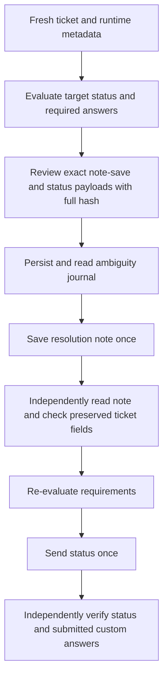

# Ticket resolution and status transitions

These commands work for incident and service-request display IDs. They resolve status choice IDs, closure-required fields and conditional business rules from fresh tenant metadata. They never copy numeric status IDs between tenants or guess a pending-reason field name.

```sh
fsv tickets resolve INC-123 --note 'Restarted the example service and verified recovery.' --dry-run
# Review the steps and copy the entire plan_hash, then repeat the same inputs:
fsv tickets resolve INC-123 --note 'Restarted the example service and verified recovery.' --yes --expect-plan FULL_HASH

fsv tickets close SR-742 --dry-run
fsv tickets reopen SR-742 --dry-run
fsv tickets status INC-123 Pending --set 'Pending Reason=Waiting for the requester' --dry-run
```

Every send requires `--yes --expect-plan FULL_HASH`. A short hash, missing confirmation, changed record or changed metadata sends nothing. Add `--set FIELD=VALUE` for each required custom answer (field name or unambiguous label). Missing requirements are listed by label and API name with exit code 2; unsupported or unavailable requirements fail closed. Existing custom fields not answered are preserved. Reopen selects the runtime **Open** choice and preserves the resolution note; it does not guess a tenant-specific custom “reopen” marker.

Resolve is intentionally **two writes, not an atomic transaction**:



Close and status transitions to Resolved/Closed require an already persisted nonempty resolution note. Use `resolve --note` first when it is missing. The status-only command does not invent a resolution. Required-for-closure flags apply only to visible fields after conditional rules; ordinary required fields and blocking rule messages also apply. `--set` currently accepts writable custom fields, not arbitrary routing/default-field changes.

Each step uses a single lower-level request without automatic CSRF-refresh replay. A timeout, rejection, incomplete readback or interruption may leave the note saved but the status unchanged. The journal remains `started` and blocks identical resubmission. Inspect the ticket and journal before preparing a different recovery plan; never blindly resend. Workflow and email side effects are tenant-controlled and are not rolled back by reopening.

Internal detail responses can wrap resolution text in `resolution_notes.notes_html`; v2 responses may return plain text. Verification and resolution-tab display share the same extraction and normalize HTML only for comparison, never for reviewed payloads or hashes. Synthetic offline fixtures test different status IDs; accepted live evidence is kept privately, outside this repository.
